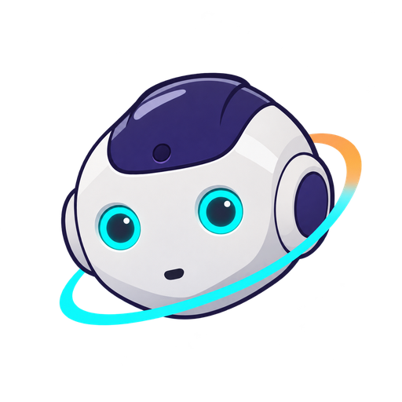
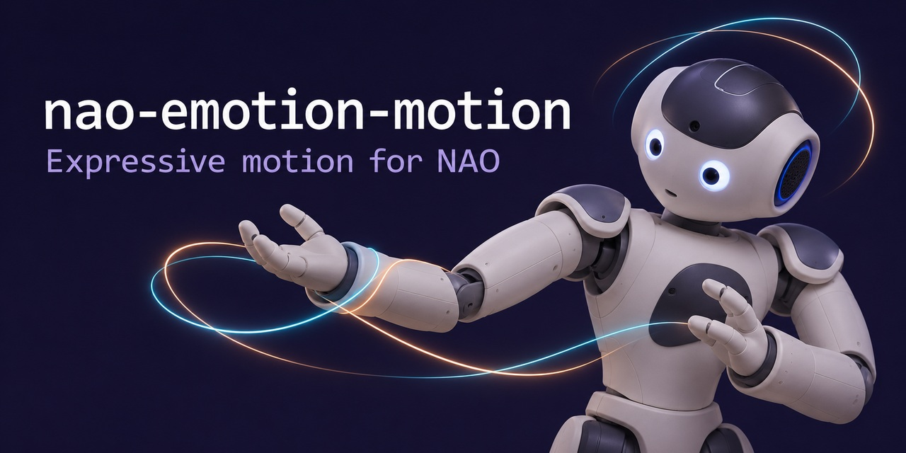

<h1>
  
  nao-emotion-motion
</h1>



# nao-emotion-motion

Learning and generating expressive **arm**, **head** and **hand** movements for NAO from physical demonstrations, conditioned on an **emotion** and an **intensity** (0 to 1).

The motion component is not an LLM. It is a small supervised neural model (PyTorch) with lightweight inference that can also run on numpy alone. An external LLM can supply the emotion and intensity, but it only ever gets a movement **proposal**: execution remains an explicit operator action.

> **Status: first foundation, validated in simulation only.** The synthetic data is there to check the technical pipeline. It says nothing about expressiveness. Nothing has been tested on a real robot yet.

> **Note on language:** the web interface and the emotion/intention identifiers are in French. Labels from the interface are quoted as they appear, with an English gloss. Emotion IDs: `joie` (joy), `tristesse` (sadness), `colere` (anger), `peur` (fear), `surprise` (surprise), `calme` (calm).

---

## Quick start (no robot)

```bash
pip install -e ".[dev]"          # numpy, pyyaml, torch (+ pytest)
nao-motion check-config          # checks configs/ and lists what is missing for the real robot
nao-motion demo                  # full walkthrough in simulation (~15 s), in ./demo_sim
cp .env.example .env             # robot identity and address (read by the config and by the bridge)
pytest                           # tests
```

`nao-motion demo` runs through the steps of the first result:

0. calibration procedure exercised on the simulated robot (no real effect, not activated);
1. collection and storage of arm demonstrations (synthetic demonstrator, simulated adapter);
2. inspection of a take and virtual replay validated by the guardian;
3. training of the arm model;
4. generation, validation, then execution of the full cycle on the simulated robot;
5. head collection, **independent of the arms**: the head is guided (here by a simulated demonstrator) for each emotion, intensity and event, while the arms stay stiff in place;
6. head training on its own, then simulated execution of the combined arms + head gesture with an event;
7. hand collection (opening driven from the interface, simulated), hand training, combined arms + head + hands gesture.

## Local collection interface

```bash
nao-motion ui                    # http://127.0.0.1:8765 (simulated adapter by default)
nao-motion ui --adapter bridge   # to the robot through the NAOqi bridge (see below)
```

The interface listens on `127.0.0.1` only. It has eight tabs:

- **1 · Bras** (arms): choose the emotion, the intensity, optionally an intention, and the **event** in the same field of view as the head tab (azimuth, elevation, distance, or no event). *Tirage aléatoire* (random draw) draws all of them together, favouring what has been recorded least (see *Balanced random draw* below). The event is stored with the take and given to the arm model, so an oriented gesture (pointing, shielding on one side, reaching out) must be made towards the direction and distance shown. The instruction is shown in large type (“surprise — 0,8 · événement 30° à gauche, 15° vers le haut, à 0,50 m”). Then: *Préparer* (prepare: releases the arms and holds the head), *Démarrer* (start: countdown, then recording of the **measured** angles and their timestamps), *Arrêter* (stop). A preview of the curves is shown without any movement, then you choose *Accepter* (accept), *Garder en attente* (keep pending), *Rejeter* (reject) or *Recommencer* (retry), with an optional annotation.
- **2 · Tête** (head): same instruction as the arms tab (emotion, intensity, **event** in the field of view, *Tirage aléatoire*), and **no arm movement is needed**: this pass is independent. In the field of view, the dot is placed by azimuth and elevation, and its size shows proximity (bigger = closer). Place it with a click or by typing azimuth, elevation and distance; the distance may stay unknown. The random draw picks azimuth, elevation and distance (log-uniform, so there are as many near events as far ones) within the ranges in `robot.yaml` (`events`), sometimes with no event if you allow it. *Préparer* (prepare) releases the head and holds the arms stiff in place, with no motorised movement. *Démarrer* (start: countdown, then recording of the measured head angles), *Arrêter* (stop). What is recorded: emotion/intensity, event, head.
- **3 · Mains** (hands): opening of NAO's fingers, `LHand` and `RHand`. It is not on/off: every value from **0 (closed)** to **1 (open)** is possible. NAO's hands cannot be moved by hand, so they are driven from this tab: one slider per hand, *Fermer* / *½* / *Ouvrir* buttons per hand and for both, an option to link the sliders, and keys in this tab (**↑ / ↓** open / close both hands by 0.1, **O** opens both, **F** closes both). Outside a recording, each setting is a short motorised movement validated by the guardian (controller armed, *Mouvements autorisés*). The tab is also the **hand pass** of the collection, independent of the arms: same instruction as the other tabs (emotion, intensity, **event** in the field of view, random draw). The event position matters here too: an event on the robot's right can open the right hand and close the left one. Arms and head stay stiff in place, nothing is released, and you set the hand opening **live** until *Arrêter*. Your setting is followed at a velocity and acceleration limited by the guardian; that filtered command and the measured opening are both recorded. Steps *Préparer* / *Démarrer* / *Arrêter* / *Raidir tout sur place* (keys 1 to 4).
- **Prises** (takes): distribution by emotion × intensity (accepted / total), filterable list, curves, virtual replay (animated cursor, smoothed replay overlaid), status and annotations.
- **Entraînement** (training): start arm, head or hand training and view the results (training and validation RMSE, comparison baseline, guardian acceptance rate).
- **Field of view: robot view / observer view**: the ⇄ button above each field of view (or the **V** key) flips left and right **on screen only**; the recorded event never changes (positive azimuth = robot's left). *Vue robot* (robot view, default): you look the same way as the robot and see the back of its head in the middle, so the robot's left is on the left. *Vue observateur* (observer view): you face the robot and see its face, so the robot's left is on the right, like a mirror. The choice applies to every field of view and is remembered by the browser. The head pictures are `nao_motion/ui/static/nao-head-back.png` (back) and `nao-head-front.png` (front), square PNGs with a transparent background; while they are missing, the drawings `nao-head-back.svg` / `nao-head-front.svg` are used. The spoken instruction now says “à gauche **du robot**” to remove any doubt.
- **Balanced random draw**: in the *Bras*, *Tête* and *Mains* tabs, the draw favours what is missing from the takes of that pass (pending and accepted takes; rejected ones are to be redone). The space is cut into cells: emotion × intensity band (low / medium / high) × event zone (azimuth right / front / left × elevation low / high × distance near / far, plus “no event” when allowed, aimed at 20 %): 216 cells with the default settings. Each cell's score is its surplus over its fair share, weighted ×4, plus the surplus of its emotion, of its intensity band and of its zone, all counted in takes; a cell is drawn with probability ∝ exp(−2 × (score − lowest score)). In practice every cell gets one take before any gets a second, and among equally filled cells those of the emotion, band or zone lagging behind win, so the totals per emotion, band and zone stay within 1–2 takes of each other at all times. The choice among the least filled cells is random, and the exact values inside the cell (intensity to 0.05, angles to the degree, log-uniform distance) are drawn uniformly. The cell aimed at and its count are shown under the button. Settings: `robot.yaml` → `events.balance` (`strength: 0` gives back the plain uniform draw). The *Génération* tab has no takes to balance: its draw is uniform over the cells.
- **Génération** (generation): choose an emotion, optionally a blend of two emotions, the intensity, a variation and the event (same field of view, same random draw). You get the curves, the guardian report on the gesture and on the full cycle, and an *Exécuter* (execute) button (disabled if the cycle is rejected).
- **Robot**: *Connecter* (connect, no movement), *Acquitter* (acknowledge), *Raidir sur place* (stiffen in place), *Retour au repos* (return to rest, explicit), *Relâcher* (release).
- **Calibration**: see “Guardian calibration” below.

The **ARRÊT** (stop) button interrupts recording, replay and execution. The posture is held and the controller is disarmed. There is **no** automatic return to rest.

**Keyboard shortcuts** (shown under the tab bar, ignored while typing in a text, number or list field, and with Ctrl, Alt or Cmd):

- **Space** releases the limbs, anywhere in the interface: the arms in the *Bras* tab, the head in the *Tête* tab, the selected group while a calibration is open, the arms and the head elsewhere. Like *Préparer*, it asks for no confirmation: a warning on the *Bras* and *Tête* tabs reminds you to hold the limbs before pressing. Releasing commands no movement.
- **1 2 3 4** run the take steps of the *Bras*, *Tête* and *Mains* tabs: *Préparer*, *Démarrer*, *Arrêter*, *Raidir sur place*. On an AZERTY keyboard, the top-row keys work with or without Shift, as does the numeric keypad.
- **→** (right arrow) runs the next step, deduced from the recording state; that step is outlined. The keys press the same buttons, with the same server-side checks.
- **Enter** accepts the take shown in preview (*Accepter* button) in the *Bras*, *Tête* and *Mains* tabs, with no confirmation. It also works from the take's *Annotation* field: type the note, then Enter. In these tabs, Enter never presses the button that kept the focus.
- **0** runs the *Tirage aléatoire* (random draw) button of the *Bras*, *Tête*, *Mains* and *Génération* tabs: emotion, intensity, angle and distance are drawn at random, favouring what has been recorded least. Like the button, it only fills in the instruction and the event: no movement. On an AZERTY keyboard, the top-row key works with or without Shift, as does the numeric keypad.
- **V** flips the field of view between the two viewpoints, in the same tabs (same as the ⇄ button).

In simulation, a synthetic demonstrator replaces your hand. The takes it produces are marked `synthetic: true`.

### External entry points (HTTP JSON)

| Route | Purpose |
|---|---|
| `POST /api/event` | Event from the camera/microphone component: `{"present": true, "azimuth": 30, "elevation": 5, "distance_m": 1.2, "unit": "deg", "frame": "torso" \| "head", "source": "camera"}` (`distance_m` in metres, optional). With `frame: "head"`, include `head_yaw_rad` and `head_pitch_rad` at measurement time; otherwise the angles read on reception are used. `{"present": false}` signals that there is no event. `ttl_s` is optional (past it, the event is treated as absent). |
| `POST /api/request` | For an LLM: `{"emotion": "joie", "intensity": 0.7}` or `{"mix": {"joie": 0.5, "surprise": 0.5}, ...}`. The response contains the trajectory, the guardian report and a `plan_id`. **Nothing is executed.** |
| `POST /api/execute` | `{"plan_id": ..., "confirm": true}`, with the controller armed: operator action. |

## Command line

```bash
nao-motion synth                        # fills data/ with SYNTHETIC takes (technical tests)
nao-motion takes --stats                # list and distribution of takes
nao-motion train arms                   # trains the arms ("accepted" takes)
nao-motion train head                   # trains the head on its own (no arm model needed)
nao-motion train hands                  # trains the hands on its own
nao-motion generate --emotion joie --intensity 0.7 --event-az 30 --event-dist 1.2 --out gesture.json
nao-motion generate --mix '{"joie":0.6,"calme":0.4}' --intensity 0.5 --variation 0.03 --seed 1
nao-motion generate --emotion peur --intensity 0.9 --simulate     # execution on the SIMULATED robot
nao-motion execute gesture.json --adapter bridge --confirm        # the only CLI path to a real robot
nao-motion robot-info                   # identity, NAOqi, factory limits, measured posture (read-only, via the bridge)
nao-motion calibrate                    # guardian calibration procedure (see "Calibration")
nao-motion calibrate --adapter sim      # the same procedure on the simulated robot
nao-motion calibration-activate configs/calibration/<file>.yaml
nao-motion capture-pose --group left_arm --name start --adapter bridge   # reads the sensors, sends nothing
nao-motion serve-inference --port 8766  # remote inference (generates, does not execute)
nao-motion export-guardian --out guardian_export   # standalone guardian for another project (see "Standalone guardian")
nao-motion export-dataset ../nao-emotion-motion-dataset --author "Name"   # dataset to publish (see "Sharing the dataset")
nao-motion import-dataset ../nao-emotion-motion-dataset   # takes, calibrations and models back into data/, configs/, runs/
```

---

## Architecture

```
configs/                versioned YAML: joints + limits, poses, emotions, guardian, robot, model
bridge/naoqi_bridge.py  NAOqi bridge (Python 2.7 or 3), the only file depending on NAOqi; runs on the robot by default
nao_motion/
  config/               loading and validation of configurations
  events.py             event context, frames, conversions
  trajectory.py         timestamped trajectory (s, rad)
  data/                 take storage, representation (B-spline), resampling
  models/               features, PyTorch MLP, checkpoints, numpy export, training sets
  training.py           independent arm / head / hand training, metrics, group-wise split
  engine.py             combined arms + head + hands generation (proposes, does not execute)
  guardian/             independent validation of the full path
  control/              controller (cycle, execution, stop), two-pass recording
  adapters/             common interface, simulation, NAOqi bridge client
  inference/            remote inference server and client
  ui/                   local web interface (standard library + HTML/JS)
  workbench.py          service layer shared by the UI, the CLI and the demo
  sim/synthetic.py      synthetic demonstrators (simulation only)
```

Data goes into `data/`, training runs into `runs/`. Both folders are ignored by git.

### Three independent models, one engine

| | Inputs | Output |
|---|---|---|
| **Arms** | emotion (one-hot, or weighted blend), intensity, event `[present, sin az, cos az, elevation, distance known, proximity 1/(1+d)]` | 8 control points × 10 joints + log(duration) |
| **Head** | same inputs | 8 control points × 2 joints + log(duration) |
| **Hands** (optional) | same inputs | 8 control points × 2 (opening 0..1) + log(duration) |

Each group is **collected and trained on its own**, in any order: no model reads another model's output, and no pass needs a recorded or generated arm gesture. The engine then gives the same instruction (emotion, intensity, event) to every available model and merges their trajectories into one gesture, which the guardian validates as a whole. A group without a model stays at its start pose (arms, head) or is not commanded (hands).

Timing (`model.yaml`, `combine.timing`): with `hold` (default), all groups start together at their own learned tempo, and a shorter group holds its final pose until the longest one ends; with `stretch`, every group is slowed down to the longest duration.

Trade-off: consistency between groups comes from the **shared instruction** (the arm points towards the event, the head looks at it, the hand on that side opens), not from a learned synchronisation. A fine timing link such as the head following the hand with a slight delay is no longer learned. A shared latent or seed across groups is a possible later improvement.

Head and hand takes recorded earlier on replayed arms (old format) remain valid: training reads only the head or hand joints. Head and hand **models** trained in the old format (which took the arms as input) are rejected on reload and must be retrained.

The target of the hand model is, by default, the command the operator gave (`hands_model.target: command`, the intention), not the hand sensor, which lags behind the motor (`measured` is available). Its control points are clipped to the 0..1 range, so the B-spline stays within it without a velocity break.

### Motion representation

- **Raw** takes (measured angles, real timestamps) are never modified.
- Each take has a **useful segment**. For an arm take, it is proposed automatically by trimming the stillness at the start and end, and it remains editable. For a head take, it is proposed the same way; for a hand take, from the opening command.
- The segment is mapped to a **phase** u ∈ [0, 1] by linear resampling over 100 points, then projected onto **8 cubic B-spline control points** per joint. The **duration** is learned separately, in log.

Why this choice: with little data, you need few output parameters. The resulting curves are smooth (continuous velocity and acceleration, which helps the guardian). The mapping between parameters and trajectory is linear, so interpolating between examples or between emotions stays consistent. This linear alignment does not register the sub-phases of a gesture (no DTW); that is a possible future improvement.

### Averaging of gestures and variants

The first model is a **deterministic regression**. If “joie” (joy) has been demonstrated in two different ways, it learns the **average** of the two, which may be a gesture never shown. The synthetic demonstrator deliberately contains such a case. For the first prototype, variants are obtained as follows:

- **interpolation**: continuous intensity and weighted blend of emotions (`--mix`);
- **variation**: smooth, reproducible noise (`--variation`, `--seed`) on the inner control points, not learned.

Planned evolution without changing the interface: the MLPs already accept a latent input `latent_dim` (0 by default). It will allow a CVAE or a mixture of prototypes, producing **learned** variants from multiple demonstrations.

### Measure rather than impose a number of takes

Each training run writes to `runs/<run>/metrics.json`:

- the RMSE (rad) on dense trajectories in training and validation, overall and per joint;
- a comparison **baseline**: the average of takes with the same emotion and a nearby intensity. If the model does no better, it should be visible;
- the duration error;
- the rate of generated trajectories accepted by the guardian over an emotion × intensity × event grid;
- a warning when the data does not allow validation (fewer than two groups).

The training/validation split is done **by group**: each take is its own group, except old head or hand takes recorded on the same replayed arm gesture, which stay on the same side.

---

## Units, axes and frames

- **Angles**: radians. **Time**: seconds. Joint names: those of NAOqi.
- **Hands** (`LHand`, `RHand`): not an angle but an **opening**, 0 = closed, 1 = open (factory range of NAO V4, read by `ALMotion.getLimits`). They are declared in `joints.yaml` (`hands`), outside the calibrated groups: the calibration does not ask for them and they stay bounded by this range. Guardian margin, velocity and acceleration of the hands are set per joint in `guardian.yaml` (`per_joint_margin`, `per_joint_velocity_rad_s`, `per_joint_acceleration`), and their rest and start openings in `poses.yaml` (`hands`). The cycle is not refused because the hands are open at rest: they join the start pose with the rest of the body.
- **Common event frame**: NAOqi `FRAME_TORSO`. x points forward, y to the robot's left, z up.
  - azimuth = atan2(y, x), **positive to the left**;
  - elevation = atan2(z, √(x²+y²)), **positive upward**.
- **Distance** (optional): in metres, from the torso to the event. The model receives the proximity 1/(1+d), which is 0.5 at 1 m and does not depend on any range fixed in advance. An unknown distance is flagged explicitly, not replaced by an arbitrary value. The ranges in `robot.yaml` (`events`) are only used for the random draw and the field of view.
- **No event**: `present: false`, encoded `[0, 0, 0, 0, 0, 0]`. An azimuth of 0 means “straight ahead” and is encoded `[1, 0, 1, 0, 0, 0]` if the distance is unknown, or `[1, 0, 1, 0, 1, 0.5]` at 1 m. These cases cannot be confused.
- A head model trained before distance was added (four event inputs) is rejected on reload and must be retrained. An arm model trained before the event was added to its inputs is also rejected and must be retrained. Arm takes already recorded keep the event that was current when they were recorded (often “no event”).
- **Conversion from the camera (head frame)**: rotation `Rz(HeadYaw) · Ry(HeadPitch)` with the head angles at measurement time. The neck translation is neglected, which remains reasonable beyond about 50 cm.
- **NAOqi conventions**: HeadYaw > 0 turns the head left, HeadPitch > 0 lowers it. Looking at an elevation *e* therefore corresponds roughly to HeadPitch = −*e*.
- Events are always stored in the common frame, with their source and timestamp.

## Data format

Each take is stored in `data/takes/<take_id>/`:

- `samples.npz`: `t` (N,) in s since the start of recording, `q` (N, J) in **measured** rad, `joints`; for a hand take, also the opening command sent (`ref_t`, `ref_q`, `ref_joints`), at the same timestamps as the measurements (old head and hand takes also hold the command sent to the replayed arms);
- `meta.json`: `take_id`, `session_id`, `kind` (`arms` | `head` | `hands`), `emotion`, `intensity`, `intention` (optional), `joints`, `unit`, `time_unit`, `guided_joints`, `driven_joints`, `event` (torso frame), `event_frame`, `segment`, `head_initial`, `hands_initial` (hand takes), `arm_source`, `arm_take_id`, `arm_generation`, `arm_gesture_id` (old format only: arm gesture replayed during a head or hand take, `null` for independent takes), `calibration_version`, `config_fingerprint`, `adapter`, `sample_rate_hz`, `synthetic`, `status` (`pending` | `accepted` | `rejected`), `annotations` (`notes`, `tags`), `created_at` and `format_version`.

Data is rejected at save time if a value is not finite, if timestamps are not strictly increasing, if the emotion is unknown, if the intensity is outside [0, 1], if the units are not the expected ones, if a joint is both guided and driven, or if an old-format head or hand take refers to an arm take that does not exist.

Checkpoints (`runs/<run>/model.pt`) contain the architecture, weights, joints, emotion list, normalisation, representation, calibration version, configuration fingerprint, training and validation takes, hyperparameters and metrics. Head and hand checkpoints are marked `independent: true`. On reload, a model is **rejected** if its emotions or joints differ from the current configuration, and a warning is issued if the calibration has changed. `model_numpy.npz` allows inference without PyTorch.

Where inference runs is set in `configs/robot.yaml` → `inference`: `location: local | remote`, `backend: torch | numpy`, `remote_url`. A trajectory computed remotely is always revalidated locally by the guardian.

### Sharing the dataset, moving to another PC

Takes (`data/`), models (`runs/`), calibration drafts and `.env` are not versioned in this repository. Saved calibrations (`configs/calibration/*.yaml`, `ACTIVE`) are not ignored but are not committed either. To keep the code repository light, the dataset is published as a **separate repository** (GitHub, or Hugging Face, which is also a Git repository):

```bash
nao-motion export-dataset ../nao-emotion-motion-dataset --author "Name"
cd ../nao-emotion-motion-dataset && git init && git add . && git commit -m "Dataset v1"   # then push
```

The export keeps only **accepted** takes recorded on the **real robot** (no `synthetic`), without the `incomplete` tag (options `--status`, `--include-synthetic`, `--include-incomplete`), with byte-for-byte copies of the takes, the calibrations they cite, `configs/emotions.yaml` and `joints.yaml`, the latest arm, head and hand models (`--no-models` to leave them out), an `index.csv`, a dataset card (`README.md`), a `LICENSE` for the data (`--license CC-BY-4.0` by default; the code stays MIT) and a `dataset.json` manifest with the sha256 of every file. `--strip-notes` empties the free-text notes. Exporting again into the same folder updates it (new takes added, changed metadata rewritten, takes no longer selected removed); its `.git` is never touched, and a `README.md` edited by hand since the last export is kept (the updated card goes to `README.generated.md`). The export folder must be outside `data/`, and is best kept outside this repository.

`import-dataset` does the reverse, for instance on a new PC after cloning the dataset repository: it checks the sha256 of every data file first (`takes/`, `calibration/`, `models/`, `configs/`; nothing is imported if one is missing or modified; `README.md`, `LICENSE` and `index.csv` may be edited by hand), copies the missing takes into `data/takes/`, adds the missing calibrations to `configs/calibration/` **without activating any**, and copies the models into `runs/` (sets `latest_<group>.txt` only if none exists). Nothing is ever overwritten.

To move everything to another PC without publishing, copying `data/`, `runs/`, `configs/calibration/` and `.env` into the clone on the new PC is enough: all paths are relative.

---

## Guardian and execution

The model **proposes**, the controller **supervises**.

- **Guardian limits**: they come only from a **calibration** measured on the robot (next section). The values in `joints.yaml` and `poses.yaml` are only used for simulation.
- **Guardian** (`nao_motion/guardian`): it accepts or rejects, never corrects. It rejects invalid formats, non-finite values, unknown joints or leg joints, incompatible joint sets and out-of-range durations. It checks **min/max limits with margin** and linear **coupled constraints** (`guardian.yaml`, including head ↔ arms) along the **full path** sampled at 100 Hz, not just at the endpoints. It limits **velocity** and **acceleration** per joint and checks the gap between the first point and the measured state. When velocity is exceeded, it reports the slowdown that would suffice, without applying it.
- Independent min/max limits and a few linear constraints **do not guarantee the absence of collisions**. The supplied constraints are examples, to be replaced by zones measured on your robot.
- **Nominal cycle** built by the controller, not learned: rest → start → gesture → start → rest. The rest ↔ start transitions are minimum-jerk. The rest pose may lie **outside the motion zone** (for example arms resting on the knees, a contact posture): it is bounded only by the factory limits, and the rest ↔ start segments are the only ones allowed to leave the zone. They are checked against the factory limits, a reduced velocity (`rest_velocity_rad_s`) and the acceleration limit, without margin or coupled constraints. Making sure the start pose is reachable from rest without contact is the responsibility of whoever calibrates. The start ↔ gesture transitions are quintic and matched in velocity and acceleration. The **entire cycle** is validated before the first command is sent, then revalidated against the measured state just before execution. It is rejected if the robot is not measured at rest (unless `from_pose="current"` is explicitly chosen).
- **Streaming execution** (setAngles at 25 Hz). At each step, the controller checks for a stop request, the connection (heartbeat) and the tracking error between command and measurement.
- **Joint roles**: a joint is *guided* (zero stiffness, read only), *driven* (stiff, commanded) or left as is. A command to a guided joint is rejected before reaching the robot: a released axis is never assumed to follow a command.
- **Stop and errors**:
  - *ARRÊT* (stop): execution is interrupted, the **measured** posture is held and the controller is disarmed.
  - *Error during execution*: the controller tries to hold the posture, goes into `FAULT` and waits for the operator to acknowledge.
  - *Connection loss*: nothing more can be sent from the PC. The **bridge watchdog**, on the robot side, then stops tasks and holds the posture if no heartbeat arrives for 0.6 s or if the client disconnects.
  - There is **never** an automatic motorised return to rest nor an automatic release. *Retour au repos* (return to rest) and *Relâcher* (release) are explicit actions, because the right reaction depends on the actual state of the robot.
- **No automatic movement** at startup, during tests or at the end of training. The controller starts disarmed, and every movement requires arming followed by an explicit action. Several tests check this.
- **Real robot**: arming is refused without an active calibration, or if the connected robot does not carry the name from the calibration or from `.env`.
- **Reboots observed during some movements**: their cause is not established here. The guardian **does not fix them** and must not be presented as a protection against them. To study them, the movements involved should be logged (trajectory, velocities, temperatures and current if available) and compared.

---

## Guardian calibration

Calibration is a procedure in its own right, done robot by robot. Its result is a versioned file, `configs/calibration/<robot>-<date>.yaml`. The active file is designated by `configs/calibration/ACTIVE`, and a calibration is never overwritten.

It is run from the **Calibration tab** of the interface (`nao-motion ui`), or in the terminal with `nao-motion calibrate`. Both use the same procedure and the same computation.

```bash
nao-motion ui                   # Robot tab: connect the robot, then Calibration tab
nao-motion calibrate            # the same procedure in the terminal, via the bridge; nothing is commanded
```

In the Calibration tab, you choose a group and proceed step by step, in any order. The table shows, live, the measured angles and the min/max widening during exploration, as well as the captured poses. For each joint pair, a scatter plot with its convex hull shows the areas not yet explored. Buttons are enabled only when the step is possible: computation waits until all groups are explored and all poses captured, activation waits for saving. Opening a calibration disarms the controller, and collection, execution and arming are refused while it remains open. Closing does not return anything to rest. In simulation, a synthetic demonstrator does the exploration, and a simulated calibration cannot be activated.

1. **Identification**: robot name, NAOqi version, hardware configuration, and factory limits read by `ALMotion.getLimits`.
2. **Guided exploration**, group by group (left arm, right arm, head). The group being explored is released and only read; the others are stiffened in place. Slowly bring each joint to its *useful* end stops, and go through the combinations (head turned **and** lowered, shoulder raised **and** spread, etc.).
3. **Rest and start poses**, captured for each group by placing the robot by hand (average of 5 readings).
4. **Computation**: the limits are the measured range, intersected with the factory limits, minus a margin (`configs/calibration.yaml`). If the exploration goes beyond a factory limit (mechanical play, a forced stop), the calibration is not rejected: the factory limit is kept, and a warning is shown and stored in the file (`warnings`). The Calibration tab shows the factory range of each joint during exploration. The **coupled constraints** come from the convex hull of each explored pair (`pairs`), simplified conservatively. The procedure is rejected if the exploration is too short or too narrow, or if a pose falls outside the hull.
5. **Review** of the summary, then save and activate (tab button, or `nao-motion calibration-activate`). From the interface, activation reloads the configuration without restarting, and the controller stays disarmed.

**Saved calibrations.** The top of the Calibration tab lists every file of `configs/calibration/`, including those from earlier sessions, with an *Activer* button; no calibration needs to be open. A file that cannot be activated says why (simulated calibration on a real robot, missing joint, pose outside the limits with the current configuration, unreadable file). The file is checked against the current configuration *before* `ACTIVE` is written, and if reloading fails the previous activation is restored. Files written by earlier versions of the software still load (`schema_version: 1` is unchanged; the hands are outside the calibration).

**Progress is kept.** Explorations, captured poses and reused groups are saved after each step in `configs/calibration/drafts/<robot>.npz` (not versioned) and restored the next time the calibration is opened, even after a server restart. *Repartir de zéro* (start over) clears them. A group can also be **reused from a saved calibration** (*Reprendre ce groupe*): its limits, coupled constraints and poses are copied, so you can keep the arms and redo only the head. Exploring a reused group replaces the reuse. The resulting file says which groups were reused (`notes`, and `imported_from` in `measured`).

An active calibration replaces limits, poses and calibration version throughout the pipeline (guardian, takes, checkpoints). The manual constraints in `guardian.yaml` are added to it, in particular between limbs (arms ↔ head, arm ↔ arm), which a joint-by-joint exploration does not measure. The convex hull assumes a convex reachable region for each pair; an L-shaped region must be split by hand.

## Standalone guardian (export for another project)

The guardian can be exported as two files, to act as a safety layer for another project (for example the NAOqi bridge of ia-agent, in Python 2.7) without depending on this repository:

```bash
nao-motion export-guardian --out guardian_export
#   guardian_export/guardian.json    limits, velocities, coupled constraints, poses (active calibration)
#   guardian_export/nao_guardian.py  Python 2.7 / 3 checker, standard library only
```

The export is **refused without an active calibration**: the fallback limits are not those of the robot. `--allow-uncalibrated` forces a test export, which the checker then refuses to load without `allow_uncalibrated=True`.

`guardian.json` (`kind: nao_motion.guardian_export`, `schema_version: 1`, angles in radians, time in seconds) contains: the source (calibration version, robot, configuration fingerprint), the groups, per-joint limits and the margin, maximum velocities (default and per joint), maximum acceleration, check frequency, duration range, start tolerance, coupled constraints `sum(coef × angle) ≤ bound` (origin `calibration` or `manual`), and the rest and start poses. Legs are rejected.

```python
from nao_guardian import Guardian
g = Guardian.load("guardian.json")
rep = g.check_pose({"HeadYaw": 0.3, "HeadPitch": -0.1})                 # a target posture
rep = g.check_move(measured_posture, target, 1.5)                       # linear move in 1.5 s
d = g.min_duration(measured_posture, target)                            # minimum allowed duration
rep = g.check_trajectory(t, joints, q, start_state=measured_posture)    # full trajectory
if not rep.ok:
    print(rep.summary())     # rep.violations: code, joint, time, value, limit
```

On the command line: `python nao_guardian.py guardian.json gesture.json` prints the verdict and returns 0 (accepted), 1 (rejected) or 2 (usage error). The gesture file uses the `nao-motion generate` format (`{"joints", "t", "q"}`, optionally inside `{"trajectory": ...}`).

The checker gives the same verdicts as the project's guardian (compared on random trajectories in the tests). It only judges: it neither modifies nor slows down any movement, and commands nothing. Python 2.7 compatibility is checked statically (syntax and imports); it has not yet been run on the robot's Python 2.7.3. After a new calibration, redo the export.

## Connecting the real robot

Identity recorded on Joachim's NAO (in `.env.example`): **naoH25, head/body/arms VERSION_40 (NAO V4), NAOqi 2.1.4.13, Python 2.7.3, name “nao”**. To record or check it on another robot, over SSH (`ssh nao@<IP>`):

```bash
qicli call ALSystem.systemVersion        # NAOqi version
qicli call ALSystem.robotName            # name (tied to the calibration)
qicli call ALMotion.getRobotConfig       # model and head/body/arm versions
qicli call ALMotion.getLimits HeadPitch  # [min, max, max velocity, max torque], per joint
python --version                         # embedded Python
```

Steps:

1. `cp .env.example .env` (not versioned): expected robot identity, bridge port. These values override those in `configs/robot.yaml`.
2. **Choose where the bridge runs.** By default (`NAO_BRIDGE_LOCATION=robot`), it runs **on the NAO**, and there is **nothing to install**: the `naoqi` module is already present in the robot's Python 2.7.3. This is also what ia-agent does (embedded `nao_ws_bridge.py`). The `pc` mode requires the NAOqi Python SDK (pynaoqi, Python 2.7), which has become hard to find and install. The bridge tries `from naoqi import ALProxy`, then `import qi` (`--api` to force one).
3. **Prepare the robot's position.** The legs stay out of scope and are never commanded. Put the robot in a stable posture, for example sitting or crouching. Handle autonomous life, breathing and idle movements from your usual tools: the bridge does not touch them, because disabling them can make the robot move depending on the version.
4. **Start the bridge**, which sends no movement at startup:
   ```bash
   # on the robot (recommended)
   scp bridge/naoqi_bridge.py nao@<IP>:/home/nao/
   ssh nao@<IP> python /home/nao/naoqi_bridge.py --on-robot   # local NAOqi, listens on network port 9600
   # or on the PC, with the pynaoqi SDK (NAO_BRIDGE_LOCATION=pc)
   python2 bridge/naoqi_bridge.py            # address supplied later by the interface
   ```
   The bridge has no authentication: on the robot, use it only on a trusted network, and stop it (Ctrl+C) after the session. To test the protocol without a robot: `python bridge/naoqi_bridge.py --fake`. The bridge accepts only one client at a time (interface **or** command).
   Then, in `nao-motion ui --adapter bridge` → **Robot** tab, choose where the bridge runs, enter the **robot address (IP or DNS name)**, for example `192.168.1.10` or `nao.local`, and click *Connecter au robot* (connect to robot). This action sends no movement and changes no stiffness. The address is remembered in the browser. On the command line, `--robot <IP or DNS>` plays the same role, with `NAO_IP` as the default.
5. `nao-motion robot-info --robot <IP or DNS>`: checks the connection and shows identity, factory limits and measured posture, without any movement.
6. `nao-motion calibrate` (previous section), then `nao-motion check-config`.
7. Adjust velocities, accelerations, stiffness (`robot.yaml` → `stiffness`) and manual constraints between limbs (`guardian.yaml`).
8. `nao-motion ui --adapter bridge`. Make a first attempt with slow gestures, a hand near the ARRÊT (stop) button, and the robot in a posture where a release would not make it fall.

Things to check on NAOqi 2.1.4 that this repository does not assume: the behaviour of `setAngles` / `killTasksUsingResources` when holding, the minimum stiffness that allows comfortable guiding, and the actual latency of 25 Hz streaming.

---

## Emotions and intentions

`configs/emotions.yaml` provides a **short, editable** list: `joie` (joy), `tristesse` (sadness), `colere` (anger), `peur` (fear), `surprise`, `calme` (calm). These are not fixed scientific categories, just working labels. **Intentions** (`accueillir` welcome, `refuser` refuse, `saluer` greet, `montrer` show) are separate from emotions: you can welcome with joy or with calm. They are recorded as take annotations but do not condition the models yet. Changing the emotion list makes old checkpoints incompatible, and they are explicitly rejected.

## Known limitations of this foundation

- The data and demonstrators are synthetic. No real expressiveness measurement.
- The NAOqi bridge and the `bridge` adapter are tested only against a fake backend. The bridge needed no change for the hands (`LHand` / `RHand` go through `getAngles`, `setAngles` and `setStiffnesses` like any joint), but hand control has not been tried on the robot yet: hand speed under `max_fraction_speed`, and the hand tracking tolerance (`execution.hand_tracking_error`), are to be checked there. A hand kept stiff and closed for a long time heats up.
- Temporal alignment is linear (no DTW). Variants are not learned yet.
- Collision constraints are linear and indicative. No geometric model of the robot.
